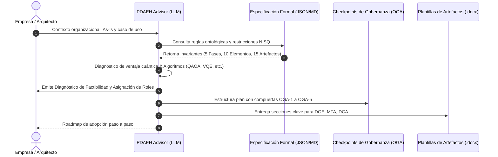

# PDAEH: Proceso para la Definición de Arquitecturas Empresariales Híbridas (Clásicas-Cuánticas)

Repositorio oficial del **Proceso para la Definición de Arquitecturas Empresariales Híbridas (PDAEH)**, desarrollado como parte de la investigación doctoral en Ingeniería de la **Universidad del Cauca** por **Carlos Orozco**.

---

## Portal de Validación por Expertos

El detalle integral de todos los componentes metodológicos que conforman el proceso se encuentra disponible y abierto al público en el portal web interactivo:

<div align="center">
  <a href="https://corozco-personal.github.io/pdaeh-tesis-doctoral/" target="_blank">
    
  </a>
  <p>
    <a href="https://corozco-personal.github.io/pdaeh-tesis-doctoral/" target="_blank"><strong>Enlace directo</strong></a>
  </p>
  <p><em>Escanea el código QR o utiliza el enlace directo para ingresar al portal web público.</em></p>
</div>

El portal web contiene el desarrollo exhaustivo de:
- **Los 10 Elementos Armonizados (E1–E10)** distribuidos en sus 3 dimensiones (Conceptual, Organizacional, Calidad y Diseño).
- **Las 5 Fases Metodológicas** del ciclo de vida (F1: Inicio y Alineación Estratégica, F2: Evaluación de Preparación Cuántica y Viabilidad, F3: Diseño y Modelado de la Arquitectura Híbrida, F4: Implementación, Integración y Pruebas Piloto, F5: Despliegue, Monitoreo y Gobernanza Continua), con sus actividades, tareas, entradas, salidas y flujos detallados.
- **La Actividad Transversal de Revisión de Líneas Base** y los puntos de control del Órgano de Gobierno Arquitectónico (OGA-1 a OGA-5).
- **El Esquema de Roles** y su matriz de adaptación según el tamaño y la madurez de la organización (Startups, PYMEs y Grandes Empresas).
- **El Catálogo de los 15 Artefactos Normativos** con sus plantillas descargables en formatos editables Word (`.docx`) y LaTeX (`.tex`).
- **El Estudio Exploratorio, la Revisión Sistemática de Literatura (RSL)** con el inventario de estudios primarios (S1–S24) y las referencias bibliográficas en formato IEEE.

---

## Agente Consultor PDAEH (Spec-Driven AI Agent)

El agente **PDAEH-Advisor** es un consultor virtual especializado, regido por especificaciones formales anti-alucinación (`PDAEH_SPECIFICATION_V1.md` y `PDAEH_SPECIFICATION_V1.json`). 

Su propósito es interactuar directamente con una empresa u organización, recibir su contexto de negocio, evaluar su arquitectura actual (*As-Is*) y entregar un **diagnóstico de idoneidad cuántica, sugerencias arquitectónicas precisas y una hoja de ruta (mapa paso a paso)** personalizada para implementar el proceso PDAEH.



---

## Instrucciones de Instalación del Agente

El agente está diseñado para configurarse en cualquier plataforma o cliente de preferencia utilizando los archivos disponibles en la carpeta [`agente-pdaeh-consultor/`](./agente-pdaeh-consultor/):

### Opción A: Google Gemini (Gems)
1. Ingresa a [gemini.google.com](https://gemini.google.com) y accede al **Administrador de Gems** (botón *Nuevo Gem*).
2. **Nombre:** `PDAEH Advisor - Consultor de Arquitectura Cuántica`
3. **Instrucciones:** Copia y pega el contenido completo del archivo [`agente-pdaeh-consultor/SYSTEM_PROMPT.md`](./agente-pdaeh-consultor/SYSTEM_PROMPT.md).
4. **Archivos de conocimiento:** Adjunta los archivos [`PDAEH_SPECIFICATION_V1.json`](./agente-pdaeh-consultor/PDAEH_SPECIFICATION_V1.json) y [`PDAEH_SPECIFICATION_V1.md`](./agente-pdaeh-consultor/PDAEH_SPECIFICATION_V1.md).
5. Guarda el Gem.

### Opción B: Anthropic Claude (Projects)
1. En [claude.ai](https://claude.ai), dirígete a la sección **Projects** y haz clic en **Create Project**.
2. **Project Name:** `PDAEH Advisor`
3. **Project Instructions:** Copia y pega el contenido del archivo [`agente-pdaeh-consultor/SYSTEM_PROMPT.md`](./agente-pdaeh-consultor/SYSTEM_PROMPT.md).
4. **Project Knowledge:** Adjunta [`agente-pdaeh-consultor/PDAEH_SPECIFICATION_V1.json`](./agente-pdaeh-consultor/PDAEH_SPECIFICATION_V1.json) y [`PDAEH_SPECIFICATION_V1.md`](./agente-pdaeh-consultor/PDAEH_SPECIFICATION_V1.md).

### Opción C: OpenAI ChatGPT (Custom GPT)
1. En [chatgpt.com](https://chatgpt.com), ve a **Explore GPTs** y haz clic en **+ Create** (pestaña **Configure**).
2. **Name:** `PDAEH Advisor`
3. **Instructions:** Pega el contenido íntegro de [`agente-pdaeh-consultor/SYSTEM_PROMPT.md`](./agente-pdaeh-consultor/SYSTEM_PROMPT.md).
4. **Knowledge:** Sube [`PDAEH_SPECIFICATION_V1.json`](./agente-pdaeh-consultor/PDAEH_SPECIFICATION_V1.json) y [`PDAEH_SPECIFICATION_V1.md`](./agente-pdaeh-consultor/PDAEH_SPECIFICATION_V1.md).
5. Guarda y publica.

---

## Ejemplo Práctico de Uso y Sugerencias del Agente

### Consulta Inicial del Usuario:
> *"Somos una PYME de logística con un equipo de 16 desarrolladores. Operamos con microservicios en la nube (AWS). Buscamos resolver la optimización de rutas de última milla con ventanas de tiempo para 400 vehículos, pues los algoritmos clásicos tardan más de 3 horas en converger. ¿Cómo nos diagnostica el marco PDAEH y cuál es el mapa paso a paso para aplicarlo?"*

### Respuesta y Mapa Paso a Paso Entregado por el Agente:

```markdown
# DIAGNÓSTICO Y HOJA DE RUTA METODOLÓGICA PDAEH

## 1. Resumen del Perfilado y Diagnóstico de Idoneidad
- **Tipo de Organización:** PYME (16 ingenieros).
- **Problema de Negocio:** Optimización combinatoria de ruteo de vehículos (VRP / TSP extendido) con ventanas horarias.
- **Complejidad y Familia Algorítmica:** Problema de optimización combinatoria NP-hard con formulación matemática cuadrática binaria (QUBO). Algoritmos híbridos idóneos: QAOA (Quantum Approximate Optimization Algorithm) o Quantum Annealing.
- **Régimen Tecnológico Sugerido:** Iniciar con simulación clásica en entorno local con modelos de ruido (Qiskit Aer / statevector) y posterior ejecución híbrida desacoplada mediante AWS Braket hacia procesadores cuánticos NISQ reales con técnicas de mitigación de error de lectura.

## 2. Asignación Metodológica de Roles (PDAEH E6 para PYME)
- **AEP (Arquitecto Empresarial Principal):** Asumido por el CTO o Líder de Arquitectura.
- **ASP (Arquitecto de Solución Principal):** Ingeniero de Software Principal (diseño de interfaces REST/gRPC y componentes híbridos).
- **AIP (Arquitecto de Plataforma e Infraestructura):** Ingeniero Cloud / DevOps (gestión de pipelines CI/CD y colas asíncronas hacia el proveedor cuántico).
- **EQP (Especialista en Computación Cuántica):** Consultor externo o investigador cuántico por horas (diseño del circuito cuántico, formulación QUBO y transpilación).
- **LNP (Líder de Negocio y Producto):** Director de Operaciones / Logística (definición de KPIs y retorno de inversión).
- **OGA (Órgano de Gobierno Arquitectónico):** Comité colegiado directivo integrado por el CTO, el Director de Operaciones y el Asesor Cuántico.
- **ASecP / GEP / GPA:** Asumidos de manera transversal por el CTO y el equipo DevOps.

## 3. Hoja de Ruta Paso a Paso para la Aplicación del Proceso (Fases F1 a F5)

### Fase 1: Inicio y Alineación Estratégica
- **Paso 1.1:** Cuantificar el caso de negocio definiendo metas de reducción de tiempo de ruteo y costos de combustible.
- **Paso 1.2:** Mapear la correspondencia entre los objetivos corporativos y las capacidades cuánticas esperadas.
- **Paso 1.3:** Formalizar el alcance del proyecto híbrido y el compromiso directivo.
- **Artefactos a diligenciar:** `DOE` (Documento de Objetivos Empresariales), `MTA` (Matriz de Trazabilidad), `DCA` (Acta de Constitución de la Arquitectura).
- **Punto de Control OGA-1:** Aprobación del caso de negocio y patrocinio directivo para continuar.

### Fase 2: Evaluación de Preparación Cuántica y Viabilidad
- **Paso 2.1:** Auditar la infraestructura actual en AWS, APIs y calidad de los datos de despacho logístico.
- **Paso 2.2:** Formular el modelo matemático QUBO y realizar benchmarking teórico frente a algoritmos clásicos (OR-Tools, Gurobi).
- **Paso 2.3:** Evaluar los costos estimados por ejecución en procesadores cuánticos NISQ.
- **Artefactos a diligenciar:** `MSP` (Matriz de Priorización de Casos de Uso), `DPV` (Documento de Preparación y Viabilidad Técnica), `DNA` (Diagnóstico As-Is).
- **Punto de Control OGA-2:** Veredicto formal de factibilidad computacional del caso QUBO.

### Fase 3: Diseño y Modelado de la Arquitectura Híbrida
- **Paso 3.1:** Seleccionar los patrones arquitecturales híbridos: Split Execution y Hybrid Variational Loop.
- **Paso 3.2:** Modelar las vistas del sistema híbrido extendiendo UML con estereotipos cuánticos.
- **Paso 3.3:** Construir la matriz de atributos de calidad (árbol de utilidad) balanceando latencia de red, tiempo de coherencia y fidelidad.
- **Artefactos a diligenciar:** `ITA` (Trade-Offs Arquitecturales), `DVA` (Vistas Arquitecturales Híbridas), `MAC` (Matriz de Atributos de Calidad).
- **Punto de Control OGA-3:** Certificación y aprobación del diseño arquitectural híbrido.

### Fase 4: Implementación, Integración y Pruebas Piloto
- **Paso 4.1:** Desarrollar el prototipo piloto en Qiskit o Amazon Braket SDK conectado a la cola de microservicios en AWS.
- **Paso 4.2:** Implementar estrategias de mitigación de ruido (Zero-Noise Extrapolation y Readout Error Mitigation).
- **Paso 4.3:** Ejecutar el banco de ensayos comparativo entre el algoritmo clásico y la solución híbrida.
- **Artefactos a diligenciar:** `DEA` (Estrategia de Adquisición y Acceso Cuántico), `DCO` (Criterios de Mitigación de Ruido), `BER` (Banco de Ensayos del Piloto).
- **Punto de Control OGA-4:** Aprobación de los resultados experimentales y autorización de avance.

### Fase 5: Despliegue, Monitoreo y Gobernanza Continua
- **Paso 5.1:** Desplegar el servicio de optimización híbrido en producción con mecanismos de fallback clásico en caso de indisponibilidad del proveedor cuántico.
- **Paso 5.2:** Establecer el cuadro de mando de monitoreo para telemetría de fidelidad de resultados y consumo de créditos de QPU.
- **Paso 5.3:** Planificar la evolución de la arquitectura hacia nuevos procesadores y migración de ciberseguridad post-cuántica (PQC).
- **Artefactos a diligenciar:** `CEP` (Cuadro de Mando y Monitoreo), `CPD` (Criterios de Paso a Producción), `LBA` (Línea Base y Plan de Evolución).
- **Punto de Control OGA-5:** Evaluación de retorno de inversión y evolución arquitectural continua.

## 4. Sugerencia y Próxima Acción Inmediata
Descargue la plantilla oficial de la Fase 1: **Documento de Objetivos Empresariales (DOE)** desde el portal web en formato `.docx` y formalice las metas de negocio del caso logístico para someterlo a la primera revisión del comité **OGA-1**.
```

---

## Estructura del Repositorio

```text
├── pdaeh-evaluacion-expertos/     # Portal web interactivo de evaluación y consulta
│   └── dist/                     # Código fuente listo para producción (HTML5, CSS3, JS Vanilla)
│       ├── index.html            # Portal principal (RSL, Armonización, 5 Fases, Roles, OGA)
│       ├── fase.html             # Vista detallada de cada fase metodológica (F1 a F5)
│       ├── plantilla.html        # Vista y visor de plantillas normativas
│       └── assets/               # Diagramas vectoriales, logos y descargas (.docx / .tex)
├── agente-pdaeh-consultor/       # Agente de IA para diagnóstico y adopción empresarial
│   ├── PDAEH_SPECIFICATION_V1.md # Especificación formal, axiomas y guardrails anti-alucinación
│   ├── PDAEH_SPECIFICATION_V1.json # Esquema formal en formato JSON Schema de las 52 actividades
│   ├── SYSTEM_PROMPT.md          # Prompt de sistema blindado por especificación
│   ├── knowledge_base_pdaeh.json # Base de conocimiento canónica
│   ├── GEMINI_GEM_INSTRUCTIONS.md # Guía para Google Gemini (Gems)
│   ├── CLAUDE_PROJECT_INSTRUCTIONS.md # Guía para Anthropic Claude (Projects)
│   └── CHATGPT_GPT_INSTRUCTIONS.md # Guía para OpenAI ChatGPT (Custom GPTs)
├── diagramas/                    # Fuentes de diagramas arquitecturales en Draw.io y SVG
├── analysis/                     # Extracciones y tablas analíticas de la monografía doctoral
├── scripts/                      # Scripts de automatización y compilación de artefactos
├── SECURITY.md                   # Política de seguridad y directrices post-cuánticas
└── README.md                     # Documentación general del proyecto
```

---

## Seguridad y Gobernanza

Consulta [SECURITY.md](./SECURITY.md) para conocer las políticas de reporte de vulnerabilidades, protección de credenciales de plataformas cuánticas y lineamientos de ciberseguridad post-cuántica (PQC).

---

## Publicaciones Científicas Vinculadas

1. **Revisión Sistemática de Literatura (RSL):**
   * SciELO / Ingenierías USBMed: [doi.org/10.21500/20275846.6433](https://doi.org/10.21500/20275846.6433)
2. **Armonización de Modelos y Elementos:**
   * Universidad Cooperativa de Colombia: [doi.org/10.16925/gcsc.130](https://doi.org/10.16925/gcsc.130)
3. **Proceso Metodológico PDAEH:**
   * JIISIC 2026: *A Process for Defining Hybrid Classical-Quantum Enterprise Architectures*.
