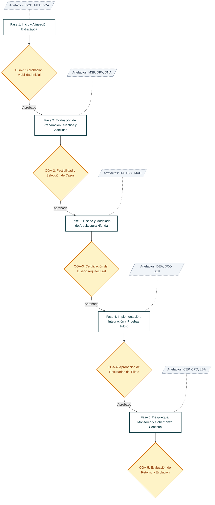
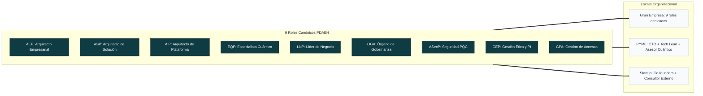
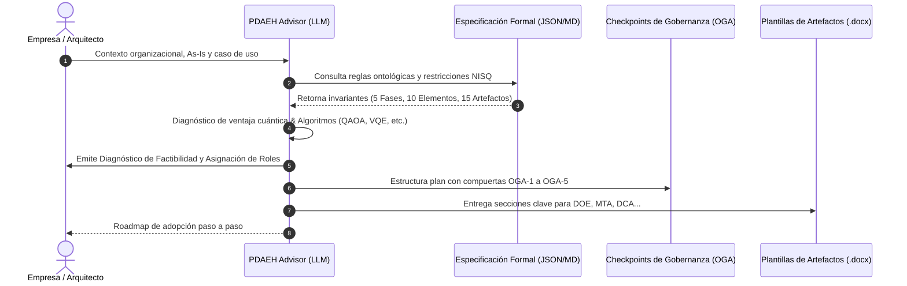

# PDAEH: Proceso para la Definición de Arquitecturas Empresariales Híbridas (Clásicas-Cuánticas)

Repositorio oficial del **Proceso para la Definición de Arquitecturas Empresariales Híbridas (PDAEH)**, desarrollado como parte de la tesis doctoral en Ingeniería de la **Universidad del Cauca** por **Carlos Orozco**.

Este repositorio unifica:
1. 🌐 **El Portal Web de Validación por Expertos**: Interfaz interactiva completa que expone el estudio exploratorio, la revisión sistemática de literatura (RSL), la armonización de elementos, las 5 fases del proceso, los 9 roles consolidados y las 15 plantillas normativas descargables (`.docx` y `.tex`).
2. 🤖 **El Agente Consultor PDAEH (Spec-Driven AI Agent)**: Especificación formal, guardrails anti-alucinación y configuración lista para desplegar en **Google Gemini (Gems)**, **Anthropic Claude (Projects)**, **OpenAI ChatGPT (Custom GPTs)** o agentes locales.
3. 📐 **Diagramas y Modelado Arquitectural**: Fuentes vectoriales editables (`.drawio`, `.svg`) de las vistas y fases metodológicas.

---

## 🏛️ Marco Metodológico PDAEH

### 1. Dimensiones y 10 Elementos Armonizados (E1 - E10)

```mermaid
graph TD
    classDef dim fill:#0f3b43,stroke:#092227,color:#ffffff,stroke-width:2px;
    classDef elem fill:#ffffff,stroke:#0f3b43,color:#1e293b,stroke-width:1.5px;

    subgraph DC ["Dimensión Conceptual"]
        direction TB
        E1["E1: Tipos de integración cuántica-clásica"]
        E2["E2: Patrones arquitecturales híbridos"]
        E3["E3: Lenguajes y marcos de modelado"]
    end

    subgraph DO ["Dimensión Organizacional"]
        direction TB
        E4["E4: Alineación estratégica de negocio"]
        E5["E5: Gobernanza y gestión del cambio"]
        E6["E6: Roles y responsabilidades"]
    end

    subgraph DCD ["Dimensión de Calidad y Diseño"]
        direction TB
        E7["E7: Atributos de calidad"]
        E8["E8: Proceso de desarrollo de software"]
        E9["E9: Métricas de diseño y evaluación"]
        E10["E10: Herramientas de soporte y simulación"]
    end

    class DC,DO,DCD dim;
    class E1,E2,E3,E4,E5,E6,E7,E8,E9,E10 elem;
```



---

### 2. Flujo de las 5 Fases del Proceso y Puntos de Control OGA



---

### 3. Matriz de Adaptabilidad de Roles según Tamaño Organizacional



---

## 🤖 Arquitectura del Agente Consultor Spec-Driven



---

## 📂 Estructura del Repositorio

```text
├── pdaeh-evaluacion-expertos/     # Portal web interactivo de evaluación y consulta
│   └── dist/                     # Código fuente listo para producción (HTML5, CSS3, JS Vanilla)
│       ├── index.html            # Portal principal (RSL, Armonización, 5 Fases, Roles, OGA)
│       ├── fase.html             # Vista detallada de cada fase metodológica (F1 a F5)
│       ├── plantilla.html        # Vista y visor de plantillas normativas
│       └── assets/               # Diagramas vectoriales, logos y descargas (.docx / .tex)
├── agente-pdaeh-consultor/       # Agente de IA para diagnóstico y adopción empresarial
│   ├── PDAEH_SPECIFICATION_V1.md # Especificación formal, axiomas y guardrails anti-alucinación
│   ├── PDAEH_SPECIFICATION_V1.json # Esquema formal en formato JSON Schema de las 52 actividades
│   ├── SYSTEM_PROMPT.md          # Prompt de sistema blindado por especificación
│   ├── knowledge_base_pdaeh.json # Base de conocimiento canónica
│   ├── GEMINI_GEM_INSTRUCTIONS.md # Guía para Google Gemini (Gems)
│   ├── CLAUDE_PROJECT_INSTRUCTIONS.md # Guía para Anthropic Claude (Projects)
│   └── CHATGPT_GPT_INSTRUCTIONS.md # Guía para OpenAI ChatGPT (Custom GPTs)
├── diagramas/                    # Fuentes de diagramas arquitecturales en Draw.io y SVG
├── analysis/                     # Extracciones y tablas analíticas de la monografía doctoral
├── scripts/                      # Scripts de automatización y compilación de artefactos
├── SECURITY.md                   # Política de seguridad y directrices post-cuánticas
└── README.md                     # Documentación general del proyecto
```

---

## 🚀 Despliegue del Portal Web

El portal está construido con estándares web universales (HTML5, CSS responsivo moderno, JavaScript Vanilla) sin dependencias de frameworks externos:

```bash
cd pdaeh-evaluacion-expertos/dist
python3 -m http.server 8085
```
Abre tu navegador en `http://localhost:8085`.

---

## 🔒 Seguridad y Gobernanza

Consulta [SECURITY.md](./SECURITY.md) para conocer las directrices de ciberseguridad post-cuántica (PQC), protección de credenciales de QPUs y reporte de vulnerabilidades.

---

## 📜 Publicaciones Científicas Vinculadas

1. **Revisión Sistemática de Literatura (RSL):**
   * SciELO / Ingenierías USBMed: [doi.org/10.21500/20275846.6433](https://doi.org/10.21500/20275846.6433)
2. **Armonización de Modelos y Elementos:**
   * Universidad Cooperativa de Colombia: [doi.org/10.16925/gcsc.130](https://doi.org/10.16925/gcsc.130)
3. **Proceso Metodológico PDAEH:**
   * JIISIC 2026: *A Process for Defining Hybrid Classical-Quantum Enterprise Architectures*.
