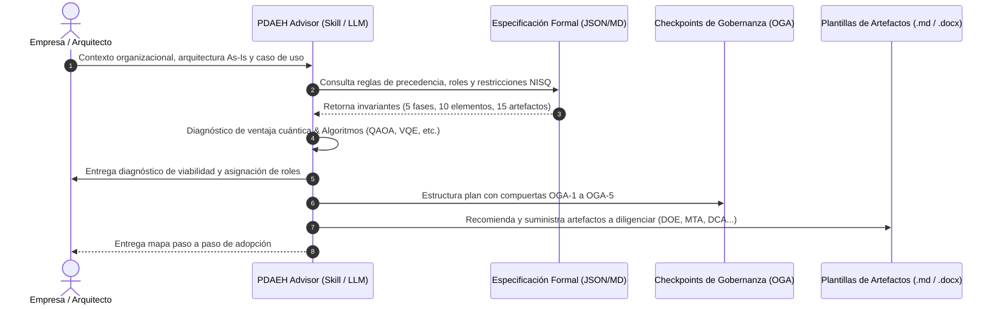

# Proceso para la definición de arquitecturas empresariales híbridas (clásicas-cuánticas)

## Complemento digital de la investigación doctoral

Este proyecto hace parte de la tesis doctoral *Arquitectura de referencia para la definición e implementación de arquitecturas de software empresariales híbridas, adaptado a las necesidades emergentes de la Ingeniería de Software Cuántica*, desarrollada por:

- **Carlos Eduardo Orozco Garcés** (Autor) — *Universidad del Cauca, Colombia*
- **César Jesús Pardo Calvache** (Director) — *Universidad del Cauca, Colombia*
- **Ricardo Pérez del Castillo** (Codirector) — *Universidad de Castilla - La Mancha, España*

**Universidad del Cauca**  
Doctorado en Ciencias de la Computación  
Popayán, Colombia  

<p align="center">
  <a href="https://corozco-personal.github.io/pdaeh-tesis-doctoral/"></a>
  <a href="agente-pdaeh-consultor/"></a>
  <a href="assets/descargas/"></a>
  <a href="LICENSE"></a>
</p>

<div align="center">
  <a href="https://corozco-personal.github.io/pdaeh-tesis-doctoral/" target="_blank">
    
  </a>
  <p>
    <a href="https://corozco-personal.github.io/pdaeh-tesis-doctoral/" target="_blank"><strong>Consultar portal web del proceso</strong></a>
  </p>
</div>

El sitio web disponible en GitHub Pages presenta el detalle riguroso de cada uno de los elementos, fases, actividades, roles, puntos de control de gobierno arquitectónico y artefactos que conforman el proceso PDAEH. Por su parte, el agente consultor toma esta base de conocimiento metodológica para brindar orientación personalizada, diagnosticar la situación de la organización y generar hojas de ruta de adopción precisas. De este modo, un usuario final puede interactuar y utilizar el agente de forma directa, y consultar el material complementario en el portal web cuando necesite comprender el detalle de algún concepto, actividad o plantilla técnica del proceso.

---

## Componentes metodológicos del proceso

El portal web interactivo reúne y formaliza los siguientes componentes:

- **Diez elementos estructurales armonizados (E1–E10)** agrupados en tres dimensiones arquitectónicas (conceptual, organizativa, y de calidad y diseño).
- **Cinco fases consecutivas** que estructuran el ciclo metodológico (Fase 1: Definición estratégica, Fase 2: Formalización conceptual, Fase 3: Configuración estructural, Fase 4: Materialización arquitectónica, y Fase 5: Sistematización del diseño), con sus actividades, tareas, entradas, salidas y flujos de trabajo detallados.
- **Actividad transversal de revisión de líneas base** y los puntos de control formal a cargo del Órgano de Gobierno Arquitectónico (OGA-1 a OGA-5).
- **Esquema de nueve roles arquitectónicos** y su matriz formal de adaptación de acuerdo con el tamaño y madurez de la organización (startups o microempresas, pymes y grandes empresas).
- **Catálogo de quince artefactos normalizados** organizados en tabla comparativa con plantillas descargables en formatos abiertos y editables: **Markdown (`.md`)**, **Word (`.docx`)** y **LaTeX (`.tex`)**.
- **Declaración formal de uso responsable de inteligencia artificial**, detallando el marco de transparencia y los procesos de auditoría y validación exhaustiva realizados por los autores.
- **Revisión sistemática de la literatura y estudio exploratorio en la industria**, con el inventario de estudios primarios (S1–S24) y referencias en formato IEEE.

---

## Agente consultor y skill metodológico PDAEH

El agente **PDAEH-Advisor** es un consultor virtual especializado, regido por especificaciones formales anti-alucinación (`PDAEH_SPECIFICATION_V1.md` y `PDAEH_SPECIFICATION_V1.json`). 

Su propósito es interactuar directamente con una empresa u organización, diagnosticar su arquitectura actual (*As-Is*), evaluar la pertinencia y factibilidad de incorporar capacidades cuánticas, y **entregar sugerencias precisas y una hoja de ruta (mapa paso a paso)** que guíe cronológicamente la aplicación de cada fase, actividad y artefacto del proceso PDAEH.



---

## Guía de instalación del agente y skill

Para instalar y activar el **Skill PDAEH** en cualquier agente o entorno de desarrollo (Antigravity, Gemini CLI, Claude Code, Cursor) sin tener que copiar archivos a mano, basta con ejecutar el siguiente comando en la terminal:

### Instalación global (recomendada para todas las sesiones y proyectos)

```bash
curl -fsSL https://corozco-personal.github.io/pdaeh-tesis-doctoral/install.sh | bash -s -- --global
```

### Instalación local (únicamente en el proyecto o espacio de trabajo actual)

```bash
curl -fsSL https://corozco-personal.github.io/pdaeh-tesis-doctoral/install.sh | bash
```

El comando descarga e instala automáticamente la especificación formal del skill (`SKILL.md`), el esquema funcional de actividades (`PDAEH_SPECIFICATION_V1.json`) y la base de conocimiento estructurada (`knowledge_base_pdaeh.json`), dejando el skill listo para su invocación inmediata.

## Ejemplo de diagnóstico y mapa de adopción generado por el agente

Al interactuar con el agente proporcionando el contexto de la empresa, este entrega un diagnóstico estructurado y un plan de acción:

```markdown
# Diagnóstico de viabilidad y mapa de adopción PDAEH

## 1. Diagnóstico de madurez y ventaja cuántica
- **Caso evaluado:** Optimización de rutas de distribución de última milla con flota eléctrica.
- **Veredicto:** Apto para arquitectura híbrida en régimen NISQ (algoritmo QAOA / VQE sobre simulador y QPU en nube).
- **Riesgo:** Alto en latencia de circuito; se prescribe patrón arquitectónico *Split Execution* con mitigación de ruido.

## 2. Asignación de roles según tamaño de la organización (Pyme)
- **AEP (Arquitecto empresarial del proceso):** Lidera alineación estratégica y absorbe la gestión de datos (ADP).
- **AIP (Arquitecto de integración):** Responsable de conectores clásicos-cuánticos y absorbe seguridad (ASecP).
- **ETC (Especialista cuántico):** Rol externo bajo demanda para formulación de Hamiltonianos y ejecución de circuitos.

## 3. Mapa de adopción paso a paso

### Fase 1: Definición estratégica
- **Paso 1.1:** Delimitar metas de reducción de costos y emisiones mediante el Documento de objetivos estratégicos (DOE).
- **Paso 1.2:** Levantar las capacidades tecnológicas actuales y restricciones normativas en el Documento de contexto arquitectónico (DCA).
- **Paso 1.3:** Formular la matriz de trazabilidad objetivos-arquitectura (MTA).
- **Punto de control OGA-1:** Validación y firma de la línea base LBA-F1 por el comité directivo.

### Fase 2: Formalización conceptual
- **Paso 2.1:** Identificar partes interesadas y expectativas en el Mapa de stakeholders (MSP).
- **Paso 2.2:** Especificar los niveles de abstracción y vistas del sistema en DPV y DNA.
- **Paso 2.3:** Unificar el glosario institucional en el Diccionario de vocabulario arquitectónico (DVA).
- **Punto de control OGA-2:** Aprobación del modelo conceptual de integración híbrida.

### Fase 3: Configuración estructural
- **Paso 3.1:** Modelar vistas lógicas y físicas de la solución híbrida en el Documento de estructuras arquitectónicas (DEA).
- **Paso 3.2:** Definir escenarios de calidad (latencia, disponibilidad y fidelidad) en el Modelo de atributos de calidad (MAC).
- **Punto de control OGA-3:** Certificación formal del diseño estructural.

### Fase 4: Materialización arquitectónica
- **Paso 4.1:** Especificar componentes de orquestación y middleware en el Documento de componentes (DCO).
- **Paso 4.2:** Catalogar algoritmos y conectores reutilizables en la Biblioteca de elementos reutilizables (BER).
- **Punto de control OGA-4:** Aprobación técnica de los artefactos de implementación.

### Fase 5: Sistematización del diseño
- **Paso 5.1:** Estandarizar patrones de diseño y estilos arquitectónicos en los catálogos CEP y CPD.
- **Paso 5.2:** Consolidar la Línea Base Arquitectónica integral (LBA).
- **Punto de control OGA-5:** Aprobación definitiva por el Órgano de Gobierno Arquitectónico (OGA).
```

---

## Publicaciones científicas vinculadas

1. **Revisión sistemática de literatura (RSL):**
   * SciELO / Ingenierías USBMed: [doi.org/10.21500/20275846.6433](https://doi.org/10.21500/20275846.6433)
2. **Armonización de modelos y elementos:**
   * Universidad Cooperativa de Colombia: [doi.org/10.16925/gcsc.130](https://doi.org/10.16925/gcsc.130)
3. **Proceso metodológico PDAEH:**
   * JIISIC 2026: *A Governance-Oriented Process for Defining Hybrid Classical-Quantum Enterprise Architectures*.
