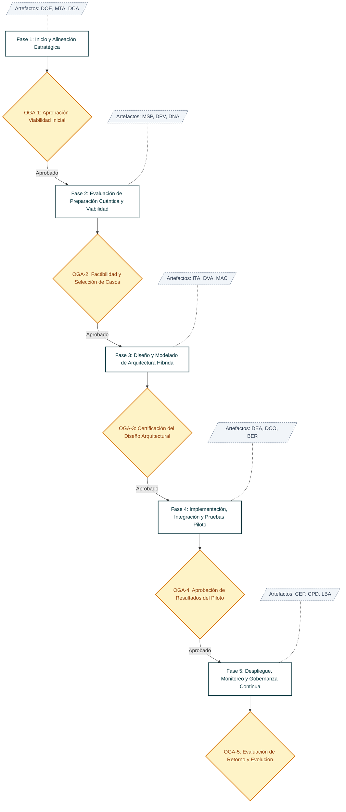
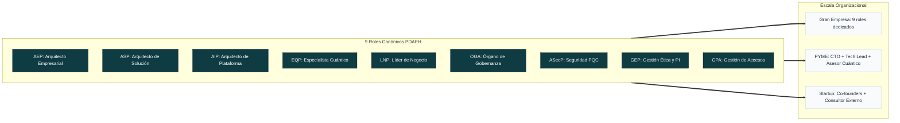
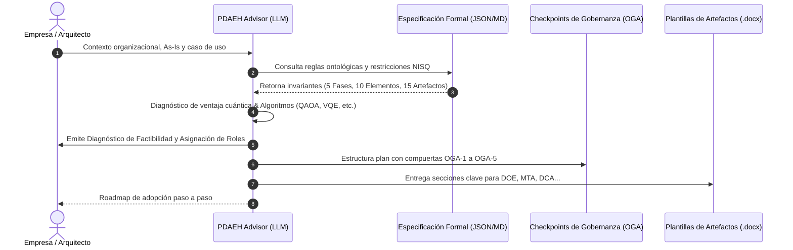

# PDAEH: Proceso para la Definición de Arquitecturas Empresariales Híbridas (Clásicas-Cuánticas)

Repositorio oficial del **Proceso para la Definición de Arquitecturas Empresariales Híbridas (PDAEH)**, desarrollado como parte de la investigación doctoral en Ingeniería de la **Universidad del Cauca** por **Carlos Orozco**.

---

## 🌐 Acceso al Portal Interactivo de Validación por Expertos

El portal web oficial de evaluación, consulta interactiva y descarga de plantillas normativas se encuentra desplegado y accesible públicamente en:

👉 **[https://pdaeh-evaluacion-expertos.carlos940807.chatgpt.site](https://pdaeh-evaluacion-expertos.carlos940807.chatgpt.site)**

<div align="center">
  <a href="https://pdaeh-evaluacion-expertos.carlos940807.chatgpt.site" target="_blank">
    
  </a>
  <p><em>Escanea el código QR o haz clic en él para acceder directamente al portal de validación.</em></p>
</div>

---

## 🏛️ Marco Metodológico PDAEH

### 1. Dimensiones y 10 Elementos Armonizados (E1 - E10)

```mermaid
graph TD
    classDef dim fill:#0f3b43,stroke:#092227,color:#ffffff,stroke-width:2px;
    classDef elem fill:#ffffff,stroke:#0f3b43,color:#1e293b,stroke-width:1.5px;

    subgraph DC ["Dimensión Conceptual"]
        direction TB
        E1["E1: Tipos de integración cuántica-clásica"]
        E2["E2: Patrones arquitecturales híbridos"]
        E3["E3: Lenguajes y marcos de modelado"]
    end

    subgraph DO ["Dimensión Organizacional"]
        direction TB
        E4["E4: Alineación estratégica de negocio"]
        E5["E5: Gobernanza y gestión del cambio"]
        E6["E6: Roles y responsabilidades"]
    end

    subgraph DCD ["Dimensión de Calidad y Diseño"]
        direction TB
        E7["E7: Atributos de calidad"]
        E8["E8: Proceso de desarrollo de software"]
        E9["E9: Métricas de diseño y evaluación"]
        E10["E10: Herramientas de soporte y simulación"]
    end

    class DC,DO,DCD dim;
    class E1,E2,E3,E4,E5,E6,E7,E8,E9,E10 elem;
```



---

### 2. Flujo Metodológico de las 5 Fases y Puntos de Control OGA



---

### 3. Matriz de Adaptabilidad de Roles según Tamaño Organizacional



---

## 🤖 Agente Consultor PDAEH (Spec-Driven AI Agent)

El agente **PDAEH-Advisor** permite a cualquier empresa u organización interactuar con un consultor virtual especializado que:
1. Diagnostica su situación técnica y de negocio (*As-Is*).
2. Determina si su problema presenta idoneidad o ventaja cuántica real (o si debe mantenerse clásico).
3. Asigna los 9 roles metodológicos según el tamaño de su equipo.
4. Genera una hoja de ruta accionable estructurada en las 5 fases del PDAEH con sus 15 artefactos normativos y puntos de aprobación OGA.



---

## 🛠️ Instrucciones de Instalación del Agente

El agente está diseñado para instalarse en cualquier cliente LLM moderno utilizando los archivos de la carpeta [`agente-pdaeh-consultor/`](./agente-pdaeh-consultor/):

### Opción A: Google Gemini (Gems)
1. Ve a [gemini.google.com](https://gemini.google.com) y abre el **Administrador de Gems** (*Nuevo Gem*).
2. **Nombre:** `PDAEH Advisor - Consultor de Arquitectura Cuántica`
3. **Instrucciones:** Copia y pega el contenido completo de [`agente-pdaeh-consultor/SYSTEM_PROMPT.md`](./agente-pdaeh-consultor/SYSTEM_PROMPT.md).
4. **Conocimiento / Archivos adjuntos:** Sube los archivos [`PDAEH_SPECIFICATION_V1.json`](./agente-pdaeh-consultor/PDAEH_SPECIFICATION_V1.json) y [`PDAEH_SPECIFICATION_V1.md`](./agente-pdaeh-consultor/PDAEH_SPECIFICATION_V1.md).
5. Guarda el Gem.

### Opción B: Anthropic Claude (Projects)
1. En [claude.ai](https://claude.ai), dirígete a **Projects** y haz clic en **Create Project**.
2. **Project Name:** `PDAEH Advisor`
3. **Project Instructions:** Copia y pega el contenido de [`agente-pdaeh-consultor/SYSTEM_PROMPT.md`](./agente-pdaeh-consultor/SYSTEM_PROMPT.md).
4. **Project Knowledge:** Sube [`agente-pdaeh-consultor/PDAEH_SPECIFICATION_V1.json`](./agente-pdaeh-consultor/PDAEH_SPECIFICATION_V1.json) y [`PDAEH_SPECIFICATION_V1.md`](./agente-pdaeh-consultor/PDAEH_SPECIFICATION_V1.md).

### Opción C: OpenAI ChatGPT (Custom GPT)
1. En [chatgpt.com](https://chatgpt.com), ve a **Explore GPTs** $\rightarrow$ **+ Create** $\rightarrow$ pestaña **Configure**.
2. **Name:** `PDAEH Advisor`
3. **Instructions:** Pega el texto de [`agente-pdaeh-consultor/SYSTEM_PROMPT.md`](./agente-pdaeh-consultor/SYSTEM_PROMPT.md).
4. **Knowledge:** Sube [`PDAEH_SPECIFICATION_V1.json`](./agente-pdaeh-consultor/PDAEH_SPECIFICATION_V1.json) y [`PDAEH_SPECIFICATION_V1.md`](./agente-pdaeh-consultor/PDAEH_SPECIFICATION_V1.md).
5. Guarda y publica.

---

## 💡 Ejemplo Práctico de Uso

### Mensaje Inicial del Usuario:
> *"Hola, somos una PYME de logística con 16 desarrolladores. Operamos con microservicios en AWS. Queremos resolver el ruteo de 400 vehículos de última milla con restricciones de ventanas horarias, ya que el algoritmo genético clásico tarda más de 3 horas en converger. ¿Cómo nos diagnostica PDAEH y cuál es nuestro plan de acción?"*

### Respuesta Generada por el Agente (Estructura Determinista):

```markdown
# 🏛️ DIAGNÓSTICO Y HOJA DE RUTA METODOLÓGICA PDAEH

## 1. Resumen del Perfilado Organizacional
- **Tipo de Organización:** PYME (16 ingenieros).
- **Problema de Negocio:** Optimización combinatoria de ruteo de vehículos (VRP / TSP extendido) con ventanas horarias.
- **Complejidad y Familia Algorítmica:** Problema NP-hard susceptible de formulación QUBO (Quadratic Unconstrained Binary Optimization). Algoritmos candidatos: QAOA (Quantum Approximate Optimization Algorithm) o Quantum Annealing.
- **Régimen Tecnológico Recomendado:** Fase de exploración en simuladores clásicos (Qiskit Aer / statevector) y posterior ejecución híbrida desacoplada mediante AWS Braket hacia QPUs NISQ con mitigación de error de lectura.

## 2. Asignación Metodológica de Roles (PDAEH E6 para PYME)
- **AEP (Arquitecto Empresarial):** Asumido por el CTO / Líder de Arquitectura de la PYME.
- **ASP (Arquitecto de Solución):** Ingeniero de Software Principal (diseña las interfaces REST/gRPC y la lógica híbrida).
- **AIP (Arquitecto de Plataforma):** Ingeniero DevOps (gestiona el pipeline CI/CD en AWS y la cola asíncrona hacia AWS Braket).
- **EQP (Especialista Cuántico):** Consultor externo o PhD en computación cuántica por horas (modelado QUBO y transpilación).
- **LNP (Líder de Negocio):** Director de Operaciones / Producto (define KPIs de reducción de tiempo de ruteo y costos de combustible).
- **OGA (Órgano de Gobernanza):** Comité directivo integrado por CTO + Director de Operaciones + Asesor Cuántico.
- **ASecP / GEP / GPA:** Asumidos de manera transversal por el CTO y DevOps.

## 3. Hoja de Ruta de Implementación (Fases F1 a F5)

### Fase 1: Inicio y Alineación Estratégica
- **Actividades:** Definir el caso de negocio cuantitativo, mapear KPIs logísticos con ventaja cuántica esperada y firmar el acta del proyecto.
- **Artefactos a diligenciar:** `DOE` (Objetivos Empresariales), `MTA` (Matriz de Trazabilidad), `DCA` (Acta de Constitución).
- **Punto de Control OGA-1:** Aprobación del patrocinio directivo y viabilidad estratégica inicial.

### Fase 2: Evaluación de Preparación Cuántica y Viabilidad
- **Actividades:** Auditar infraestructura en AWS, formular el problema en grafo/QUBO y realizar benchmarking teórico vs. solvers clásicos (OR-Tools, Gurobi).
- **Artefactos a diligenciar:** `MSP` (Priorización de Casos), `DPV` (Viabilidad Técnica), `DNA` (Diagnóstico As-Is).
- **Punto de Control OGA-2:** Validación de factibilidad computacional del caso QUBO.

### Fase 3: Diseño y Modelado de la Arquitectura Híbrida
- **Actividades:** Aplicar el patrón *Split Execution* y *Variational Loop*, modelar componentes con UML extendido y definir el Utility Tree de calidad (latencia vs. fidelidad).
- **Artefactos a diligenciar:** `ITA` (Trade-Offs), `DVA` (Vistas Arquitecturales), `MAC` (Atributos de Calidad).
- **Punto de Control OGA-3:** Certificación y aprobación del diseño de arquitectura híbrida.

### Fase 4: Implementación, Integración y Pruebas Piloto
- **Actividades:** Construir el prototipo en Qiskit/Braket SDK, aplicar mitigación de ruido (Zero-Noise Extrapolation) y medir aceleración frente al algoritmo genético clásico.
- **Artefactos a diligenciar:** `DEA` (Estrategia de Acceso QPU), `DCO` (Mitigación de Ruido), `BER` (Banco de Ensayos del Piloto).
- **Punto de Control OGA-4:** Aprobación de resultados experimentales del piloto.

### Fase 5: Despliegue, Monitoreo y Gobernanza Continua
- **Actividades:** Puesta en producción como servicio asíncrono, telemetría de costos por ejecución en QPU y monitoreo de degradación.
- **Artefactos a diligenciar:** `CEP` (Cuadro de Mando), `CPD` (Paso a Producción), `LBA` (Línea Base y Evolución).
- **Punto de Control OGA-5:** Evaluación de retorno de inversión y evolución arquitectural hacia nuevos procesadores.

## 4. Próximo Paso Inmediato
Descargue la plantilla oficial de la Fase 1: **Documento de Objetivos Empresariales (DOE)** desde el portal web e ingrese los KPIs de despacho logístico para iniciar la evaluación del checkpoint **OGA-1**.
```

---

## 📂 Estructura del Repositorio

```text
├── pdaeh-evaluacion-expertos/     # Portal web interactivo de evaluación y consulta
│   └── dist/                     # Código fuente listo para producción (HTML5, CSS3, JS Vanilla)
│       ├── index.html            # Portal principal (RSL, Armonización, 5 Fases, Roles, OGA)
│       ├── fase.html             # Vista detallada de cada fase metodológica (F1 a F5)
│       ├── plantilla.html        # Vista y visor de plantillas normativas
│       └── assets/               # Diagramas vectoriales, logos y descargas (.docx / .tex)
├── agente-pdaeh-consultor/       # Agente de IA para diagnóstico y adopción empresarial
│   ├── PDAEH_SPECIFICATION_V1.md # Especificación formal, axiomas y guardrails anti-alucinación
│   ├── PDAEH_SPECIFICATION_V1.json # Esquema formal en formato JSON Schema de las 52 actividades
│   ├── SYSTEM_PROMPT.md          # Prompt de sistema blindado por especificación
│   ├── knowledge_base_pdaeh.json # Base de conocimiento canónica
│   ├── GEMINI_GEM_INSTRUCTIONS.md # Guía para Google Gemini (Gems)
│   ├── CLAUDE_PROJECT_INSTRUCTIONS.md # Guía para Anthropic Claude (Projects)
│   └── CHATGPT_GPT_INSTRUCTIONS.md # Guía para OpenAI ChatGPT (Custom GPTs)
├── diagramas/                    # Fuentes de diagramas arquitecturales en Draw.io y SVG
├── analysis/                     # Extracciones y tablas analíticas de la monografía doctoral
├── scripts/                      # Scripts de automatización y compilación de artefactos
├── SECURITY.md                   # Política de seguridad y directrices post-cuánticas
└── README.md                     # Documentación general del proyecto
```

---

## 🔒 Seguridad y Gobernanza

Consulta [SECURITY.md](./SECURITY.md) para conocer las políticas de reporte de vulnerabilidades, protección de credenciales de QPUs y lineamientos de ciberseguridad post-cuántica (PQC).

---

## 📜 Publicaciones Científicas Vinculadas

1. **Revisión Sistemática de Literatura (RSL):**
   * SciELO / Ingenierías USBMed: [doi.org/10.21500/20275846.6433](https://doi.org/10.21500/20275846.6433)
2. **Armonización de Modelos y Elementos:**
   * Universidad Cooperativa de Colombia: [doi.org/10.16925/gcsc.130](https://doi.org/10.16925/gcsc.130)
3. **Proceso Metodológico PDAEH:**
   * JIISIC 2026: *A Process for Defining Hybrid Classical-Quantum Enterprise Architectures*.
